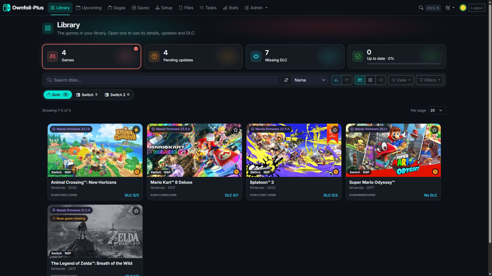
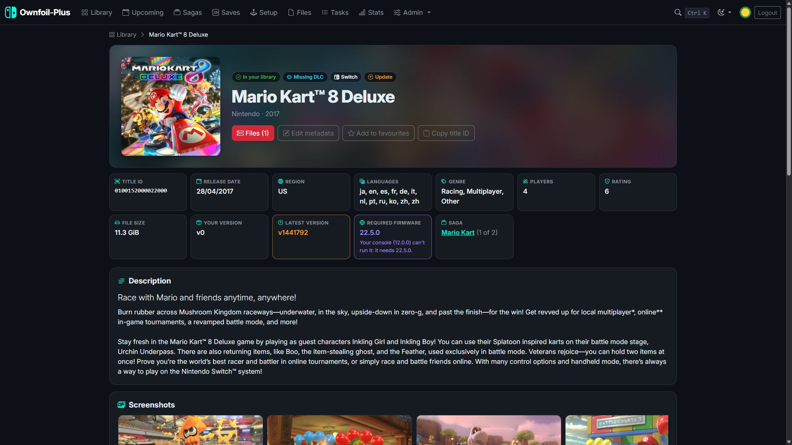
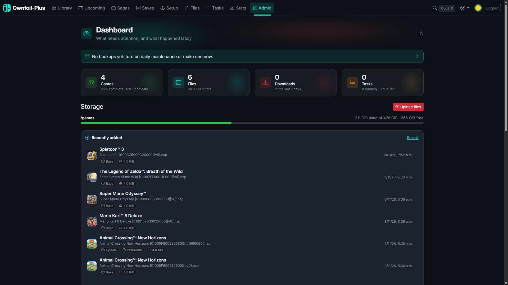
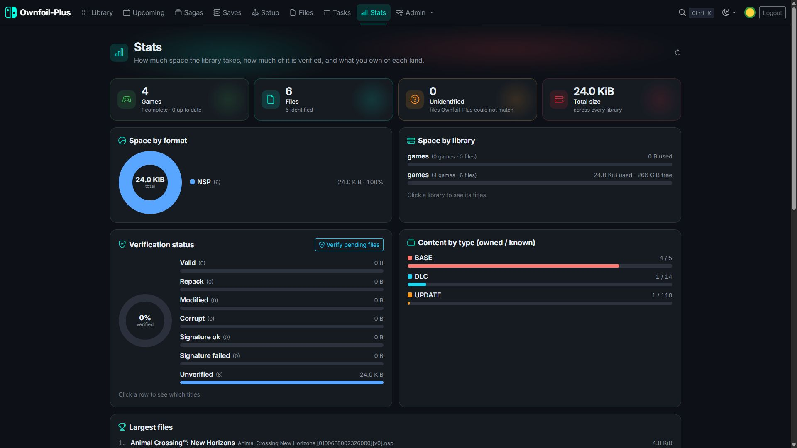
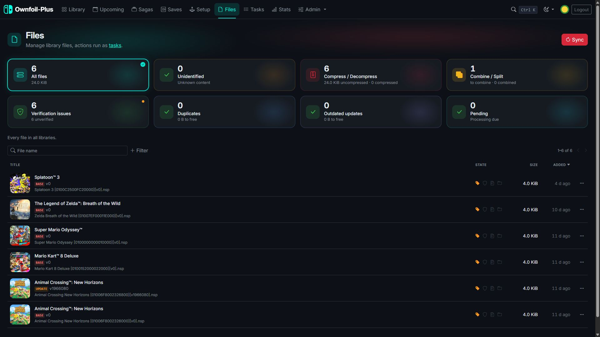
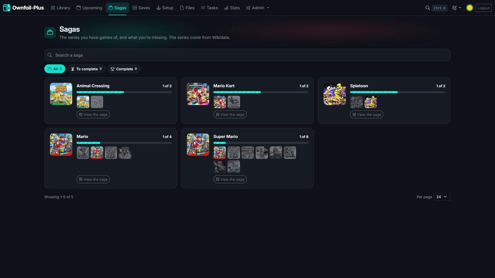
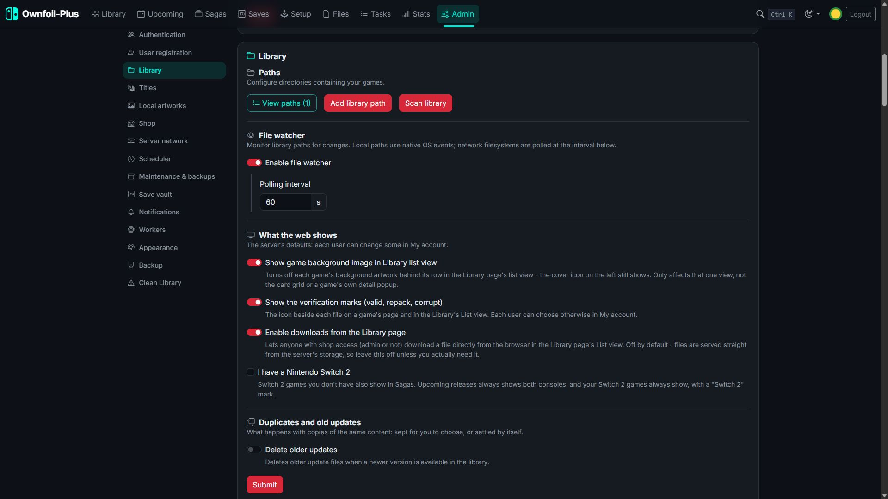
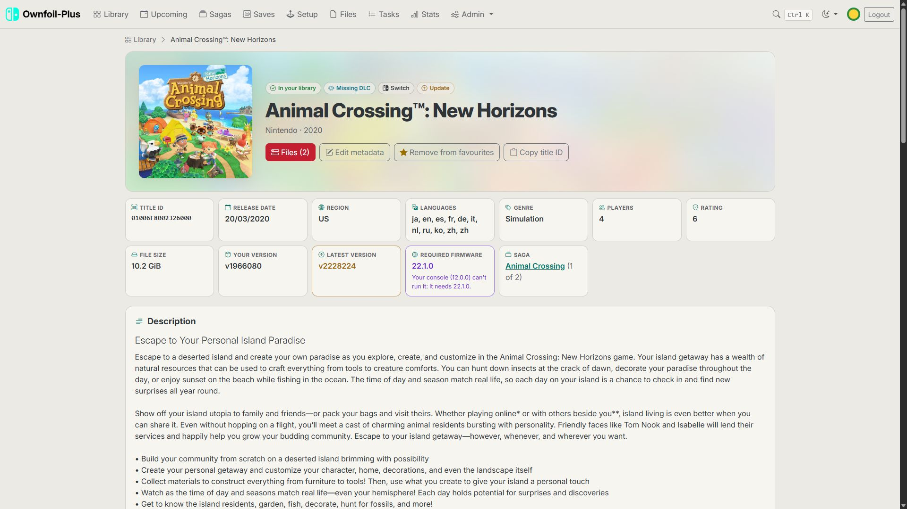
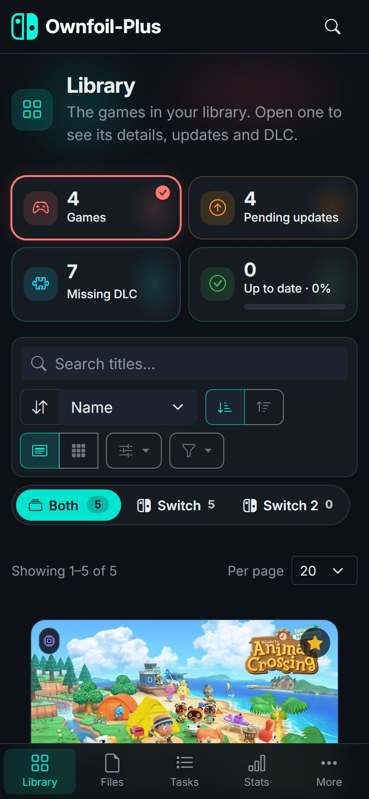

# Ownfoil-Plus

[](https://github.com/EstebanKZL/ownfoil-plus)
[](https://github.com/EstebanKZL/ownfoil-plus/releases/latest)
[](https://hub.docker.com/r/estebankzl/ownfoil-plus/tags)
[](https://hub.docker.com/r/estebankzl/ownfoil-plus)


Ownfoil-Plus turns a folder of game files into a fully organized, self-verified, self-hosted Nintendo Switch library and shop: it figures out what you have, flags what's missing or broken, keeps your files tidy, and serves everything to your console and your browser - in your language, from one web interface, with no manual bookkeeping.

It's a fork of [Ownfoil](https://github.com/a1ex4/ownfoil) by [@a1ex4](https://github.com/a1ex4), built for people who want a managed shop without babysitting it: an interface in 11 languages, an admin toolkit deep enough to fix problems instead of just reporting them, accounts for family and friends, and a Docker image that keeps itself patched.

## Screenshots

| | |
|---|---|
|  |  |
| **Library** - covers, firmware, pending updates and missing DLC at a glance | **Game page** - your version against the latest, the firmware it needs, its saga |
|  |  |
| **Dashboard** - what needs attention, storage, latest additions and downloads | **Stats** - space by format and library, verification, content by type |
|  |  |
| **Files** - verification, duplicates, outdated updates, compress and combine | **Sagas** - the series you have games of, and what you're missing |
|  |  |
| **Settings** - grouped by topic, each option under the switch it depends on | **Light and dark themes**, three styles, 11 languages |

<p align="center"></p>

## Why this image

- **Rebuilt on a schedule, not just on release.** The `latest` tag is rebuilt every week from the newest release, pulling fresh base-image and OS security patches even on weeks with no code changes.
- **Scanned before it ships.** Every change runs a full test suite (2,000+ tests), `pip-audit` on the Python dependencies and a Trivy scan of the built image that fails on fixable critical or high vulnerabilities. pip itself is removed from the final image.
- **Multi-arch from day one**: `amd64`, `arm64/v8`, `arm/v7` and `arm/v6` - the same image on a NAS, a Raspberry Pi or a full server.
- **Works offline on your LAN.** Every script, style and font is served by the container itself: no CDN, no tracking, nothing loaded from the internet to show a page.
- **Health check and metrics built in**: `/api/health` for Docker and uptime monitors, `/metrics` for Prometheus.

## Features

### Your library, understood
- **Identifies** every NSP, NSZ, XCI, XCZ and **NUP** file by its own metadata (or its name when keys are missing): game, updates and DLC, with the version shown on the console.
- **NUP files** (decrypted games) are read without keys: one file with its game, updates and DLC, the parts it holds listed on the game page, checked file by file by SHA-256, never offered to consoles that can't install them and never treated as a duplicate of an NSP.
- **What's missing**: updates and DLC that exist for the games you own, with counters for missing DLC, pending updates and games up to date.
- **Firmware**: the firmware each game and update needs - from TitleDB, and from your own files when TitleDB doesn't know it - marked against each user's console firmware.
- **Verifies** files (signature and hash) and tells valid, repacked, modified and corrupt files apart.
- **Organizes** files into folders and names you choose with templates, taking each game's NFO, SFV and proof files along.
- **Duplicates and old updates** cleaned up safely: automatically only when verification gives a clear answer, otherwise you choose.
- **Compression** to NSZ/XCZ and back, a file watcher that picks up new files as they arrive, and a scheduled daily maintenance with database backups.

### Game pages and browsing
- A **game page** for every title: banner, artwork, description, screenshots, facts (size, players, rating, languages, firmware), its updates and DLC, and a **Files** dialog to download any file - or all of them - straight from the browser.
- **One card per game** with clear badges (up to date, missing DLC, needs newer firmware), grid and list views, filters and sorting.
- **Upcoming releases** with a wishlist per user, and **Sagas** showing which games of each series you own, miss, or are still to come.
- Editable game info that survives catalogue updates, and local artwork that keeps working when the image host is down.
- **Ctrl+K search** across games and admin pages.

### Shop for your consoles
- Serves the library as a shop to **Tinfoil**, **Sphaira** and **CyberFoil**, private (user and password) or public.
- **LAN discovery**: Sphaira finds the shop on your network with no address to type in.
- Per-user **download history**, kept for good: per day, per title, per user and per client.

### Users and accounts
- Users with separate permissions: shop, save backups, administration.
- **Public registration** (optional) with email verification and password reset over **SMTP**, and **Sign in with Google**.
- **My account**: profile picture (a gallery or your own image), console firmware, email and password.
- **Save vault**: JKSV uploads each user's save backups over WebDAV into their own space, with a Saves page to download or delete them.

### Administration
- A **dashboard** with alerts, storage per library, recent files and downloads, and **resumable web uploads** (choose the library folder, with its free space).
- A **Services** panel to switch the store, public shop, file watcher, registration, maintenance, notifications, the save vault and LAN discovery on and off.
- A **Files admin page** to search, filter, retry, verify, compress, decompress or delete any file, and live **Tasks** with what each worker is doing.
- **Statistics**: space by format and library, verification status, largest files, downloads.
- **Notifications** to Discord, Telegram, ntfy or any webhook: new files, available updates, corrupt files, failed tasks, save backups.
- Settings backup and restore, Prometheus metrics, and a health check.

### Interface
- 🌐 The whole interface in **11 languages**: English, Español, Français, Deutsch, Italiano, Português, Nederlands, Русский, 日本語, 한국어 and 简体中文 - automatic from the browser's language, or picked from the menu. Notifications too.
- **Light and dark** themes and three color styles; each browser can pick its own.
- Works on phones (a real mobile layout) and installs as an app (**PWA**).

## Quick start

```bash
docker run -d -p 8465:8465 \
   -v /path/to/your/library:/games \
   -v ./config:/app/config \
   -v ./data:/app/data \
   -e USER_ADMIN_NAME=admin -e USER_ADMIN_PASSWORD=change-me \
   --name ownfoil-plus \
   estebankzl/ownfoil-plus
```

Or with Docker Compose:

```yaml
services:
  ownfoil-plus:
    container_name: ownfoil-plus
    image: estebankzl/ownfoil-plus:latest
    environment:
      - PUID=1000                 # owner of the files written in /app/config
      - PGID=1000
      - USER_ADMIN_NAME=admin     # created/updated at every start
      - USER_ADMIN_PASSWORD=change-me
      # - USER_GUEST_NAME=guest   # a regular user with shop access
      # - USER_GUEST_PASSWORD=change-me-too
      # Account emails (registration, password reset):
      # - SMTP_HOST=smtp.gmail.com
      # - SMTP_PORT=587
      # - SMTP_SECURITY=TLS
      # - SMTP_USER=shop@example.com
      # - SMTP_PASSWORD=your-app-password
      # - SMTP_FROM=Ownfoil-Plus <shop@example.com>
      # Sign in with Google:
      # - GOOGLE_CLIENT_ID=1234567890-abc.apps.googleusercontent.com
      # - GOOGLE_CLIENT_SECRET=GOCSPX-...
      # - GOOGLE_REDIRECT_URI=https://shop.example.com/login/google/callback
    volumes:
      - /path/to/your/library:/games
      - ./config:/app/config
      - ./data:/app/data
    ports:
      - "8465:8465"
    # LAN discovery needs host networking (remove "ports" above if you use it):
    # network_mode: host
    restart: unless-stopped
```

Then open `http://<your-server-ip>:8465`, sign in, add your library folder and upload your console keys in **Settings**.

> **Create the admin account first.** Until one exists, anyone who can reach the web UI can change the configuration - set `USER_ADMIN_NAME` / `USER_ADMIN_PASSWORD`, or create it in Settings right away.

## Volumes and ports

| Path / port | What it is |
| --- | --- |
| `/games` | Your library. Mount as many folders as you like and add each one in Settings. |
| `/app/config` | Settings, database, keys, backups, save vault. **Back this one up.** |
| `/app/data` | TitleDB cache and artwork. |
| `8465/tcp` | Web UI, shop, WebDAV for JKSV (`/dav/`). |
| `8465/udp` | LAN discovery (needs `network_mode: host`). |

## Environment variables

| Variable | What it does |
| --- | --- |
| `PUID` / `PGID` | User and group that own the files in `/app/config`. Default `1000:1000`. |
| `USER_ADMIN_NAME` / `USER_ADMIN_PASSWORD` | Creates (or updates) an admin at every start. |
| `USER_GUEST_NAME` / `USER_GUEST_PASSWORD` | Creates (or updates) a regular user with shop access at every start. |
| `OWNFOIL_SECRET_KEY` | Signs login cookies and email links. Generated and kept in `config/.secret_key` when unset. |
| `SMTP_HOST`, `SMTP_PORT`, `SMTP_SECURITY`, `SMTP_USER`, `SMTP_PASSWORD`, `SMTP_FROM` | Mail server for account emails. `SMTP_SECURITY`: `TLS` (587), `SSL` (465) or `NONE`. |
| `GOOGLE_CLIENT_ID`, `GOOGLE_CLIENT_SECRET`, `GOOGLE_REDIRECT_URI` | Sign in with Google (OAuth web client). |
| `OWNFOIL_METRICS_TOKEN` | Bearer token for Prometheus to read `/metrics` without an admin password. |

## Public registration: SMTP and Google in five minutes

1. Set **Settings > Registration > Server's public address** to the address people use, e.g. `https://shop.example.com` (behind a reverse proxy with HTTPS).
2. **Email**: with Gmail, turn on 2-step verification, create an [app password](https://myaccount.google.com/apppasswords) and use `SMTP_HOST=smtp.gmail.com`, `SMTP_PORT=587`, `SMTP_SECURITY=TLS`, `SMTP_USER` = your address, `SMTP_PASSWORD` = the app password, `SMTP_FROM` = your address. Outlook: `smtp.office365.com`, same port and security. Any provider's SMTP works.
3. **Google**: in the [Google Cloud console](https://console.cloud.google.com/) set up the OAuth consent screen (External, scopes `openid email profile`), then create an **OAuth client ID** of type *Web application* with the authorized redirect URI `https://shop.example.com/login/google/callback`. Put its client ID and secret in `GOOGLE_CLIENT_ID` / `GOOGLE_CLIENT_SECRET`, and that same URI in `GOOGLE_REDIRECT_URI`.
4. Recreate the container, check that Settings > Registration shows both as **Set up**, send a test email, and turn on **Allow public registration**.

Full guide: [Public registration in Install.md](https://github.com/EstebanKZL/ownfoil-plus/blob/main/Install.md#public-registration-email-smtp-and-google-sign-in).

## Tags

- `latest` - the newest release, rebuilt weekly with fresh security patches.
- `6.2.5.N` - a specific release (see [releases](https://github.com/EstebanKZL/ownfoil-plus/releases)).

## Documentation

- Installation, reverse proxy, HTTPS, Prometheus: [Install.md](https://github.com/EstebanKZL/ownfoil-plus/blob/main/Install.md)
- Every page and setting: [Usage.md](https://github.com/EstebanKZL/ownfoil-plus/blob/main/Usage.md)
- What changed in each version: [CHANGELOG.md](https://github.com/EstebanKZL/ownfoil-plus/blob/main/CHANGELOG.md)
- Source code, issues and releases: https://github.com/EstebanKZL/ownfoil-plus

## About this project

Ownfoil-Plus is a modified version of Ownfoil, an open-source project created by [@a1ex4](https://github.com/a1ex4), distributed under the GNU AGPLv3 license. As required by the AGPLv3, the complete source code of this modified version - including these changes - is publicly available at https://github.com/EstebanKZL/ownfoil-plus.
